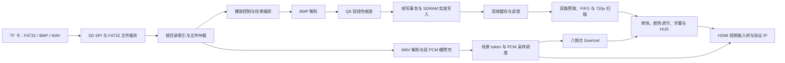

# 映界：基于安路 EG4S20 的 HDMI 多媒体播放系统

“映界”是一套面向数字展陈、离线信息发布和教学演示的 FPGA 多媒体播放终端。工程以安路 HX4S20C 开发板和 EG4S20BG256 FPGA 为目标，由 FPGA 独立完成 TF 卡读取、FAT32 目录与簇链管理、BMP 图片解析与缩放、SDRAM 帧缓存、WAV 音频播放、HDMI 输出和本地按键交互，不需要外部处理器参与播放控制。

本仓库对应 **base HUD 双线性缩放冻结工程**。HDMI 输出为固定 1280×720、60 Hz；播放资源是 BMP 图片和同名 WAV 音频。

## 目录结构

```text
全部代码/
├── constraints/
│   ├── hx4s20_pins.adc       # HX4S20C 引脚与电气约束
│   └── hx4s20_timing.sdc     # 时钟、时序及 CDC 边界约束
├── project/
│   └── yingjie_hx4s20.al     # Anlogic TD 工程，顶层及源文件清单
└── src/
    ├── ip/anlogic_hdmi/     # 配套 HDMI 1.4b 加密 IP 包装文件
    └── rtl/
        ├── audio/           # WAV 播放、PCM 队列、Goertzel 频谱
        ├── common/          # PLL、复位同步、FIFO 和跨域通信
        ├── control/         # 资源目录、播放编排、按键和菜单
        ├── display/         # 字模、HUD、HDMI 与 TMDS 适配
        ├── memory/          # SDRAM 控制、帧事务和后端接口
        ├── storage/         # SD SPI、FAT32、BMP/WAV 文件服务
        ├── top/             # 板级顶层和系统集成顶层
        └── video/           # 缩放、帧管理、预取、转场和像素流水
```

工程一共引用 66 个 Verilog HDL/IP 输入。`.al` 工程和 RTL 通过相对路径关联；将工程克隆或解压后，请保持 `project/`、`src/` 和 `constraints/` 三个目录的相对位置。

## 功能概览

- 通过板载 TF 卡槽和四线 SD SPI 读取 FAT32 根目录中的媒体文件。
- 扫描并索引最多 4 张 BMP 图片和 4 个 WAV 文件，按大小写不敏感的 8.3 短文件名主文件名配对。
- 检查 FAT32 卷信息、文件簇链和媒体格式；文件访问在图片及音频客户端间仲裁。
- 解析 24 位未压缩 BMP，支持正高度和负高度图片，并按比例居中缩放、补黑边。
- 支持 Q8 双线性插值；缩放在加载侧完成，显示端扫描已生成的 720p 帧。
- 使用合封 SDRAM 保存两个输出帧区，支持最多 16 个可见帧的淡入淡出。
- 播放 48 kHz、16 位、双声道 PCM WAV，通过 HDMI 输出音视频。
- 使用场景 token 将图片提交和同名音频准备关联；新场景在 HDMI 接受匹配首帧时切换音频槽。
- 支持手动切图、自动轮播、滚动字幕、状态信息、设置菜单、亮度/对比度调节和八频点频谱 HUD。
- 通过异步 FIFO、请求/应答 mailbox、帧锁和取消排空处理多时钟域数据及资源生命周期。

## 系统数据流



## 关键算法与实现

### 1. FAT32 文件访问与媒体配对

`media_sd_startup` 管理卡初始化、卷挂载和根目录扫描。SD SPI 初始化期间使用低速时钟，正常读块使用约 25 MHz SCLK；块读取器检查命令 CRC7 和数据 CRC16，完整收到并校验的扇区才交给上层。

`fat32_file_service` 根据 MBR/BPB 信息定位 FAT32 数据区，遍历根目录并读取文件簇链。图片和音频文件以短文件名主文件名配对，例如：

```text
SCENE01.BMP
SCENE01.WAV
```

文件服务和仲裁器管理多个文件客户端。图片扇区暂存器允许文件服务先结束当前扇区请求，再按缩放器的反压节奏消费数据；WAV 客户端通过 PCM 队列容量预留控制读取，降低音频队列耗尽风险。

### 2. BMP 流式解析与 Q8 双线性缩放

`bmp_stream_decoder` 校验 BMP 文件头及 DIB 字段，支持 24 位 `BI_RGB`，按 BMP 行填充规则读取 BGR 像素并输出 RGB888。正高度 BMP 的底向上行序和负高度 BMP 的顶向下行序会转换成统一的图像坐标。当前默认尺寸上限为 1920×1080。

`bilinear_frame_scaler` 计算保持宽高比的目标有效区域，居中放置并将帧区其他像素清为黑色。对目标有效区域中的像素坐标 `(u, v)`，源图横、纵坐标使用 8 位小数权重：

```text
qx = floor(256 × u × 源宽 / 目标有效宽)
x0 = floor(qx / 256), fx = qx mod 256, x1 = min(x0 + 1, 源宽 - 1)

y0 = floor(v × 源高 / 目标有效高)
fy = floor(256 × (v × 源高 mod 目标有效高) / 目标有效高)
y1 = min(y0 + 1, 源高 - 1)
```

四邻点为 `C00`、`C10`、`C01`、`C11`。每个颜色通道按定点整数计算，水平中间结果保留小数，最后统一四舍五入：

```text
H0   = 256 × C00 + (C10 - C00) × fx
H1   = 256 × C01 + (C11 - C01) × fx
Cout = (256 × H0 + (H1 - H0) × fy + 32768) >> 16
```

缩放器用两行 RGB 缓存保存相邻源行，边缘邻点钳位到最后一行/列。插值流水按状态复用寄存乘法器处理 RGB 通道和水平/垂直阶段，避免保存整幅源图或为每个通道配置独立乘法器。最近邻缩放 RTL 也保留在工程中；本板级顶层默认启用双线性路径。

### 3. SDRAM 双帧缓存与转场

一幅 1280×720 输出帧包含 `921600` 个像素。像素按 32 位字写入 SDRAM，RGB888 位于高 24 位，低 8 位写零：

| 项目 | 容量 |
|---|---:|
| 单帧 | 921,600 字，3,686,400 字节 |
| 双帧 | 1,843,200 字，7,372,800 字节，约 7.03 MiB |
| 合封 SDRAM | 2M × 32 位，8 MiB |

写入帧与显示帧分别管理。显示期间，帧读锁阻止写侧覆盖正在扫描的帧；转场期间两帧都处于读锁保护。写事务以 `BEGIN/WRITE/FLUSH/CANCEL` 命令进入存储域，只有物理写入完成并收到应答后，应用层才发布整帧已就绪。SDRAM 写入合并为最多 256 字的行内突发，读预取同样受帧边界和突发边界约束。

转场控制在帧边界更新 alpha，由旧帧逐步混合至新帧。16 个可见帧对应约 `16 / 60 = 0.267` 秒的名义转场时长。

### 4. PCM 双槽与音画场景提交

`wav_stream_decoder` 校验 RIFF/WAVE、PCM 格式字段和 data 长度，音频格式为 48 kHz、16 位、双声道。双 PCM 槽允许当前音频继续播放时，后台读取并预充下一场景音频；EOF 与最后一个样本保存在同一队列项中，避免文件结束事件越过尾部样本。

图像、帧提交和音频槽使用同一场景 token。新的 PCM 槽不会因为“图片读完”立即切换，而是在相应场景的首帧被 HDMI 输入端接受后切换。采样时钟由 74.25 MHz 像素时钟域的有理数相位累加器产生 48 kHz 节拍，HDMI 音频时钟恢复参数为 `N=6144`、`CTS=74250`。

### 5. 八频点 Goertzel 频谱

`audio_spectrum_goertzel` 对实际输出 PCM 的左右声道取平均，以 256 个样本为一个窗口，计算以下八个离散频点：

| 频点序号 | Goertzel 系数索引 k | 分析频率 |
|---:|---:|---:|
| 1 | 1 | 187.5 Hz |
| 2 | 2 | 375 Hz |
| 3 | 4 | 750 Hz |
| 4 | 8 | 1,500 Hz |
| 5 | 16 | 3,000 Hz |
| 6 | 24 | 4,500 Hz |
| 7 | 32 | 6,000 Hz |
| 8 | 48 | 9,000 Hz |

每个频点按 Goertzel 递推计算：

```text
s[n] = x[n] + 2cos(2πk/256) × s[n-1] - s[n-2]
P[k] = s[255]² + s[254]² - 2cos(2πk/256) × s[255] × s[254]
```

系数采用 Q20 表示，八个频点通过一组寄存乘法器分时计算，历史状态映射到 RAM。单个 256 点窗口约 5.33 ms。结果缩放并饱和为 16 位等级后，HUD 在帧边界锁存幅值，保持同一视频帧内的柱高稳定。基础 HUD 显示绿/黄/红分段柱、灯条、刻度线和边框；峰值保持、动态高度平滑和频率标签未在本版启用。

### 6. 多时钟域与取消排空

工程主要时钟域为控制/媒体加载、SDRAM 事务和 HDMI 像素处理。跨域连续数据使用异步 FIFO；配置、场景及会话控制使用保持载荷的 mailbox 和请求/应答同步。复位异步置位、各时钟域同步释放。取消请求会阻断新工作，但资源只有在 SPI/SDRAM/FIFO 等在途事务排空并确认后才能复用，避免旧场景响应写入新场景。

## 硬件与时钟

| 项目 | 配置 |
|---|---|
| 开发板 | 安路 HX4S20C |
| FPGA | EG4S20BG256，EG4 系列 |
| 板载参考时钟 | 50 MHz |
| 控制与媒体加载时钟 | 100 MHz |
| SDRAM 事务时钟 | 125 MHz |
| HDMI 像素时钟 | 74.25 MHz，1280×720@60 Hz |
| HDMI 串行时钟 | 约 371.25 MHz |
| HDMI 连接器 | HDMI_B |
| TF 卡 | 板载卡槽，SD SPI |

时钟产生及管脚映射位于 `src/rtl/common/` 和 `constraints/`。工程内另有 SDRAM 物理时钟与读采样相位时钟；请保留随工程提供的 ADC/SDC 约束，不要在其他板卡上直接套用。

冻结 Route 版本的资源和静态时序记录如下。它们描述本项目对应的特定冻结输入和 Tang Dynasty 版本，不代表不同源码、不同策略或不同器件上的结果。

| 资源/检查 | 使用量/结果 |
|---|---:|
| Slice | 8,712 / 9,800（88.90%） |
| LUT | 15,703 / 19,600（80.12%） |
| 寄存器 | 9,821 / 19,600（50.11%） |
| BRAM9K / BRAM32K | 54 / 64（84.38%） / 9 / 16（56.25%） |
| DSP / PLL / 全局时钟 | 15 / 29 / 2 / 4 / 4 / 16 |
| Routed 建立 WNS / TNS | +0.107 ns / 0 ns |
| Routed 保持 WNS / TNS | +0.003 ns / 0 ns |

对应工具版本为 Tang Dynasty 6.2.1 Engineer（6.2.168.116）。本 GitHub 精简工程包没有附 Route 数据库或完整审计报告；若需复核上述数字，应使用同一冻结源码、器件、工具和约束重新构建，并保存新的报告。

## 媒体准备

1. 将 TF 卡格式化为 FAT32。使用普通 SD 卡和板载卡槽；开始前先备份卡内文件。
2. 将媒体直接放在 FAT32 卷根目录，不要放在子目录中。
3. 图片使用未压缩 24 位 BMP（`BI_RGB`），宽高均大于零且不超过 1920×1080；支持 BMP 规定的正/负高度行方向。
4. 音频使用 PCM WAV：48 kHz、16 位、双声道。压缩 WAV、单声道/其他采样率不属于本版支持格式。
5. 图片和音频按 8.3 短文件名主文件名配对，例如 `SCENE01.BMP` 与 `SCENE01.WAV`。文件系统以根目录枚举顺序建立图片序号，不保证按文件名排序。
6. 目录容量默认为最多 4 张图片及 4 个音频文件；演示时只保留一组不超过该容量的素材。

## 安装、编译与下载

### 开发环境

- Windows 10/11。
- Anlogic Tang Dynasty 6.2.1 Engineer，项目记录版本为 6.2.168.116。
- 与 EG4S20BG256 对应的器件数据库和 HX4S20C 板卡资料。
- HX4S20C 开发板及其 USB/JTAG 下载连接；HDMI 显示设备建议支持 720p60。

### 在 Tang Dynasty 中打开与构建

1. 从 GitHub 克隆仓库或下载 ZIP，解压后不要单独移动 `project/yingjie_hx4s20.al`；保留 `src/` 和 `constraints/` 的相对目录。
2. 启动 Tang Dynasty，打开 `project/yingjie_hx4s20.al`。
3. 确认器件为 `EG4S20BG256`、顶层模块为 `yingjie_hx4s20_top`，工程载入 66 个 Verilog/IP 输入，并关联 `constraints/hx4s20_pins.adc` 与 `constraints/hx4s20_timing.sdc`。
4. 在 TD 中运行综合，再运行布局布线。保存本次工程的综合、布局布线和时序报告；检查工程没有丢失源文件或约束。
5. 要生成 `.bit`，使用与本工程和器件匹配的 TD Bitgen 流程。此 GitHub 代码包不包含预编译 `.bit`、独立 bitgen 脚本、构建数据库或测试日志；运行成功也不能替代对本次时序和配置报告的检查。

HDL 使用安路 EG4 系列原语/加密 HDMI IP，不能仅靠 Icarus Verilog 等通用开源模拟器完成器件级综合。包中未包含开发期仿真平台及测试素材。

### 下载到开发板

1. 确认 `.bit` 是由当前 RTL、ADC/SDC 和正确器件构建的文件；不要把其他版本的位流改名后当成当前工程产物。
2. 按板卡手册连接 HX4S20C 下载接口，在 Anlogic BitWriter 中选择 EG4S20 目标器件及生成的 `.bit`。
3. 使用 JTAG 配置 SRAM 做易失下载，并等待 BitWriter 报告下载成功。
4. 将显示器接到 HDMI_B，插入准备好的 FAT32 TF 卡，按 KEY1 复位，等待卡初始化、目录扫描和第一张图片加载。
5. JTAG SRAM 配置断电后会丢失。Flash 固化和断电启动是另外的配置流程，本工程目录不含固化脚本或 `.bit`。

## 板上操作

按键动作在释放时确认。KEY1 为低有效复位；KEY2 和 KEY4 经过同步与消抖。

| 按键 | 菜单关闭时 | 菜单打开时 |
|---|---|---|
| KEY2 短按 | 切换到下一张图片 | 选择下一设置项 |
| KEY2 长按（约 0.8 秒） | 循环选择 1/3/5 秒轮播停留档 | 将当前设置恢复默认 |
| KEY4 短按 | 开启/停止自动轮播 | 修改当前设置值 |
| KEY4 长按（约 0.8 秒） | 打开菜单 | 关闭菜单 |
| KEY2 + KEY4 同时按住约 2 秒后全部释放 | 取消当前事务并重新扫描 TF 卡 | 同左，关闭菜单 |

设置菜单包括轮播周期、亮度、对比度、字幕和频谱开关。亮度和对比度均以 16 为步进循环调节；字幕内容是 RTL 内的固定字符串，本版没有文件字幕或运行时文字编辑功能。

状态 LED 对应如下（板上丝印 LED1–LED4）：

| LED | 含义 |
|---|---|
| LED1 | 应用文件/播放错误 |
| LED2 | 系统忙 |
| LED3 | 视频故障或欠流 |
| LED4 | 音频欠流、Goertzel overrun 或 HDMI 未锁定的合并状态 |

## 源码导航

| 目录 | 主要职责 | 代表模块 |
|---|---|---|
| `src/rtl/top/` | 板级引脚和时钟域集成 | `yingjie_hx4s20_top.v`, `yingjie_system_core.v` |
| `src/rtl/storage/` | SD SPI、FAT32 和 BMP/WAV 文件流 | `sd_spi_block_reader.v`, `fat32_file_service.v`, `bmp_stream_decoder.v`, `wav_stream_decoder.v` |
| `src/rtl/control/` | 根目录索引、状态控制和交互 | `media_catalog.v`, `media_application_core.v`, `media_playback_ctrl.v`, `board_ui_ctrl.v` |
| `src/rtl/video/` | 图片缩放、帧事务/扫描、场景会话和转场 | `bilinear_frame_scaler.v`, `bilinear_rgb_interpolator.v`, `video_scanout_stream.v`, `video_transition_ctrl.v` |
| `src/rtl/memory/` | SDRAM 命令与双帧访问 | `sdram_cmd_controller.v`, `frame_store_adapter.v`, `eg4s20_sdram_backend.v` |
| `src/rtl/audio/` | WAV 播放、PCM 队列、采样与频谱 | `wav_file_player.v`, `pcm_dual_scene_stream.v`, `pcm_playback_engine.v`, `audio_spectrum_goertzel.v` |
| `src/rtl/display/` | HUD 字模、像素处理及 HDMI/TMDS 适配 | `video_hud.v`, `video_pixel_pipeline.v`, `hdmi_av_output.v` |
| `src/rtl/common/` | PLL、异步 FIFO、配置/场景跨域 | `eg4s20_system_pll.v`, `rgb_async_fifo.v`, `scene_audio_cdc.v` |
| `src/ip/anlogic_hdmi/` | 配套 HDMI 1.4b 加密 IP 接口 | `hdmi_1_4b_transmitter_core_wrapper.enc.v` |

## 仓库与版本说明

- 当前目录是便于公开托管的精简工程快照：保留综合输入、板级约束和 TD 工程文件；测试平台、素材生成工具、历史实验、布局布线数据库、日志与 bitstream 未放入其中。
- 发布或复现时请给提交打 Git tag，并记录完整 commit ID、TD 版本、板卡型号和构建报告。
- 工程中的 HDMI 加密 IP 和器件原语来自安路工具链/配套资料。公开仓库前请核对供应商对该 IP 文件及器件资料的再分发许可。
- 本仓库是工程源码。构建结果、板上运行时长、实际显示设备兼容性和声音效果应以相应版本的报告与实测记录为准。
